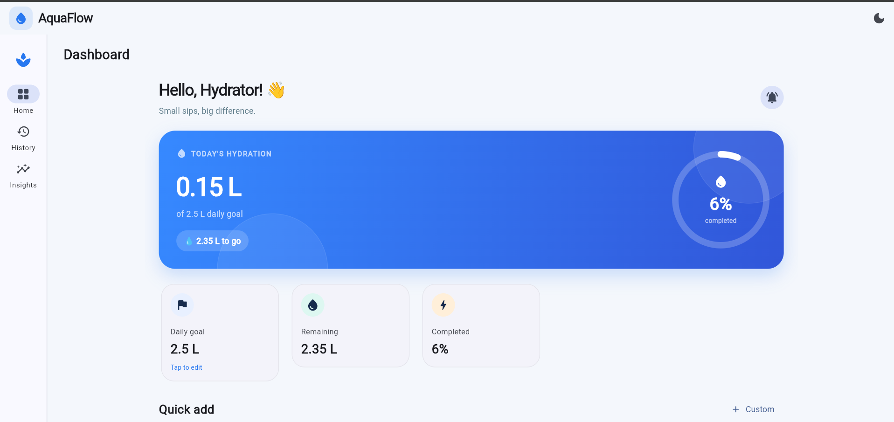
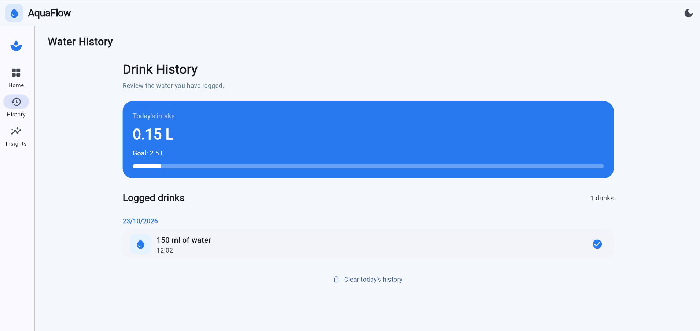
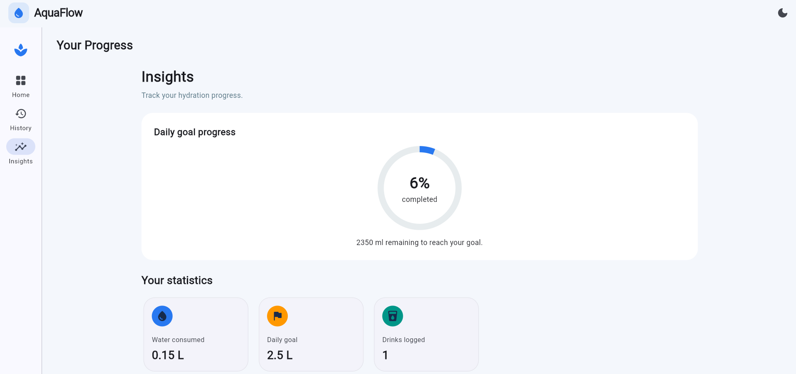

# AquaFlow – Smart Water Intake
🌐 Live Demo: https://sreenithyareddi.github.io/Aqua-Flow/
📂 Source Code: https://github.com/sreenithyareddi/Aqua-Flow/
## Problem Statement
Create a Daily Water Intake dashboard layout using Row, Column and Stack in Flutter.

## About the Project
AquaFlow is a responsive Flutter application that helps users track their daily water intake, monitor hydration progress, and manage their personal water goals.

## Features
- Daily water intake dashboard with a progress indicator
- Quick-add water amounts (150 ml, 250 ml, and 500 ml)
- Custom water entry
- Editable daily water goal
- Drink history and hydration insights
- Undo the last entry and reset daily intake
- Light and dark themes
- Responsive navigation for mobile and desktop layouts

## Flutter Concepts Used
- **Row:** Arranges widgets horizontally.
- **Column:** Arranges widgets vertically.
- **Stack:** Layers decorative elements and the hydration progress indicator.
- **LayoutBuilder:** Adapts the interface to available screen width.
- **Reusable Widgets:** Keeps the UI modular and easier to maintain.

## SDG Relevance
**SDG 3 – Good Health and Well-being**

AquaFlow encourages users to build healthy hydration habits by tracking daily water intake and monitoring progress toward personal goals. It supports awareness of everyday habits that contribute to general well-being.

## Technologies Used
- Flutter
- Dart
- Material Design

## How to Run
1. Install Flutter and set up the development environment.
2. Clone this repository.
3. Open a terminal in the project directory.
4. Run the following commands:

```bash
flutter pub get
flutter run -d chrome
```

## Screenshots




## Data Storage
Water intake entries are currently stored in memory and may reset when the application restarts.

## Author
Sree Nithya Reddi
